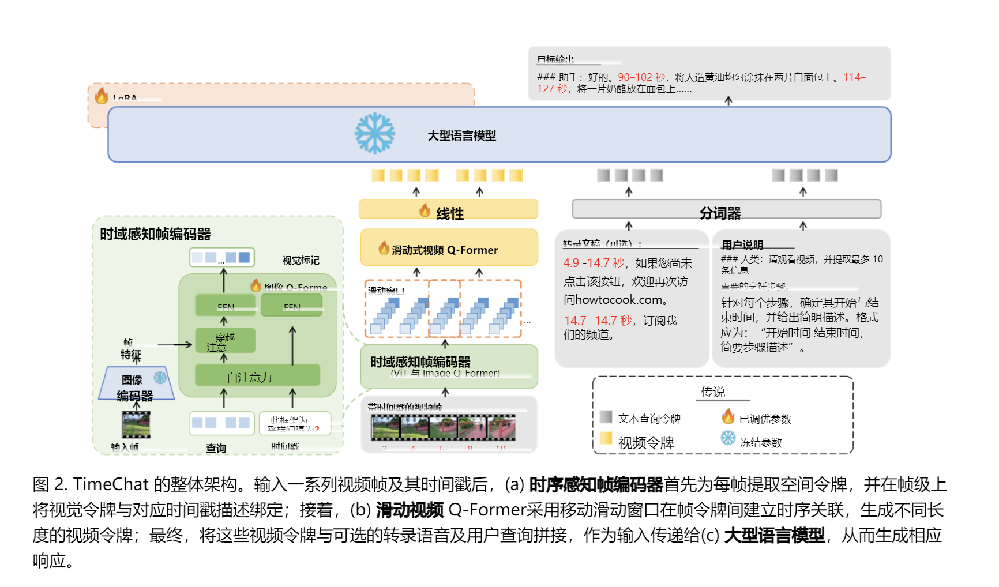
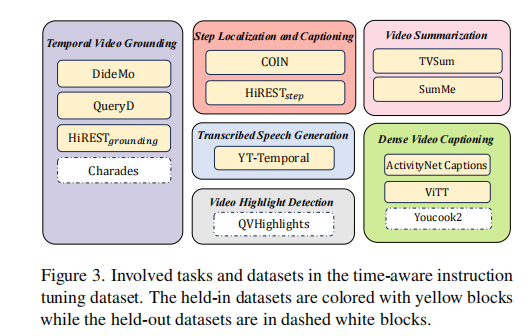

# TimeChat 阅读笔记

## 目录

- [基本信息](#基本信息)
- [1. 一句话总结](#1-一句话总结)
- [论文指出的已有模型缺陷](#论文指出的已有模型缺陷1introduction)
- [创新点与主要贡献](#创新点与主要贡献abstract--1introduction)
- [实现的成果](#实现的成果1-introduction)
- [TimeChat 架构拆解](#timechat-架构拆解31-timechat-architecture)
  - [整体架构图](#1-整体架构图)
  - [输入：视频帧、时间戳与用户问题](#2-输入视频帧时间戳与用户问题)
  - [模块一：时间感知帧编码器](#3-模块一时间感知帧编码器)
  - [模块二：滑动视频 Q-Former](#4-模块二滑动视频-q-former)
  - [模块三：线性层与 LLM](#5-模块三线性层与-llm)
  - [训练方式](#6-训练方式)
  - [与动作序列检测的联系](#7-与动作序列检测的联系)
- [TimeIT 指令数据](#timeit-指令数据32-instruction-data-timeit)
  - [任务覆盖](#321-任务覆盖附录a)
  - [数据构建](#322-数据构建附录b)
- [实验部分：TimeChat 如何验证模型有效性](#4-实验部分timechat-如何验证模型有效性4-experiments)
  - [4.1 实现细节](#41-实现细节模型怎样训练)
  - [4.2 评测设置](#42-评测设置在哪些任务上测)
  - [4.3 定量结果与评价指标](#43-定量结果分数是否优于已有模型)
  - [4.4 定性案例](#44-定性案例模型实际回答是否可信)
  - [4.5 消融实验](#45-消融实验每个模块真的有用吗)
  - [4.6 进一步分析](#46-进一步分析排除其他原因)
  - [4.7 与专用模型的比较](#47-与专用模型的比较通用模型的边界)

## 基本信息

- **论文**：TimeChat: A Time-sensitive Multimodal Large Language Model for Long Video Understanding
- **主题**：长视频理解、时间感知、多模态大模型
- **代码**：待确认
- **阅读日期**：2026.10.22


## 1. 一句话总结

TimeChat 通过“可变长度的视频表示 + 帧级视觉时间绑定 + 时间感知指令数据”，让多模态大模型更能处理长视频，并提升事件的时间定位与推理能力。

## 论文指出的已有模型缺陷（1.Introduction）

1. 固定长度的视频表示难以覆盖不同长度的视频，长视频中的时序细节容易被压缩或丢失。
2. 视觉信息与时间信息缺少显式关联，因此模型难以进行准确的时间定位。

## 创新点与主要贡献（Abstract & 1.Introduction）

### 1. 提出面向长视频的时间敏感多模态大模型 TimeChat

TimeChat 的目标不仅是理解视频内容，还要实现更准确的时间定位，
即同时回答“发生了什么”和“什么时候发生”。

### 2. 提出滑动视频 Q-Former，解决长视频固定长度表示的问题

传统方法通常将视频压缩为固定数量的 video token，
难以适应时长差异很大的视频。

TimeChat 使用滑动窗口：每次将窗口内的视频帧压缩为 video token，
然后移动窗口，从而生成长度可变的 token 序列。

- 可以适应不同视频时长；
- 尽量保留长视频中的关键视觉语义；
- 得到更具表达能力、也更可扩展的视频表示。

### 3. 提出时间感知帧编码器，增强视觉与时间的关联

模型将每一帧的视觉内容与该帧的时间戳描述显式绑定，
使模型能够把画面信息与时间信息对应起来。

这一设计的目标是提升模型的时间定位能力。

### 4. 构建时间感知指令微调数据集 TimeIT

作者构建了 TimeIT，用于训练模型理解包含时间戳的用户指令。

- 覆盖 6 类任务；
- 整合 12 个常用学术基准；
- 共约 125K 条样本；
- 视频平均长度为 190.8 秒；
- 将原始数据集转换为对话形式，并加入人工编写的高质量指令。

作者称 TimeIT 是首个以时间感知视频为中心的指令微调数据集。

## 实现的成果(1. Introduction)

作者在零样本设置下，评估了 TimeChat 在以下任务上的表现：

- 密集视频描述（dense video captioning）；
- 时间视频定位（temporal video grounding）；
- 视频高光检测（video highlight detection）。

与此前的视频大语言模型相比，TimeChat 在多个数据集上取得提升：

- YouCook2：F1 提升 9.2，CIDEr 提升 2.8；
- QVHighlights：HIT@1 提升 5.8；
- Charades-STA：R@1（IoU=0.5）提升 27.5。

此外，作者展示了它在电影和第一视角视频等新领域的泛化能力，
并将其定位为可服务于长视频理解任务的视频助手。


## TimeChat 架构拆解(3.1. TimeChat Architecture)

> 重点解释 TimeChat 的数据流与模块职责。

### 1. 整体架构图



TimeChat 的核心目标是：把长视频转换为既保留内容、又带有时间信息的表示，再让大语言模型根据用户问题生成带时间定位的回答。

TimeChat 由三部分组成：

1. 时间戳感知帧编码器（Timestamp-aware Frame Encoder）；
2. 滑动视频 Q-Former（Sliding Video Q-Former）；
3. 大语言模型（LLM）。

整体数据流为：

```text
带时间戳的视频帧
  -> 时间戳感知帧编码器
  -> 帧级视觉 token
  -> 滑动视频 Q-Former
  -> 视频 token
  -> 与文本查询 token 拼接
  -> LLM
  -> 自然语言回答
```

### 2. 输入：视频帧、时间戳与用户问题

一段视频首先被采样为一系列帧。每帧除了图像内容外，还有其在原视频中的时间位置，例如“该帧采样自 2 秒”。

文本侧输入包括：
- 用户指令，例如要求找出视频中的关键步骤及其起止时间；
- 可选的语音转录文本；
- 训练阶段的目标答案。
其中，用户指令和可选语音转录共同构成文本查询。

### 3. 模块一：时间感知帧编码器

该模块逐帧处理视频，目标是让每个视觉 token 同时包含画面内容与时间信息。
具体过程如下：
1. 使用预训练图像编码器 ViT 分别编码每一帧，获得帧特征；
2. Image Q-Former 使用 N_I 个可学习查询向量，与帧特征进行交叉注意力交互；
3. Image Q-Former 将一帧的视觉信息压缩为 N_I 个视觉 token；
4. 该帧的时间戳描述，例如 “This frame is sampled at 2s.”，作为 Q-Former 的条件输入；
5. 因此，最终获得的视觉 token 不仅反映画面内容，也与该帧发生的时间绑定。
对于 T 帧视频，该模块输出 T × N_I 个视觉 token。

### 4. 模块二：滑动视频 Q-Former

经过帧编码后，虽然每帧已有视觉 token，但不同帧之间的时间关系还没有建模。
滑动视频 Q-Former 的处理方式是：
1. 取长度为 L_W 的连续帧组成一个滑动窗口；
2. 使用 N_V 个可学习查询向量，从该窗口内多帧的视觉 token 中提取 N_V 个视频 token；
3. 窗口以步长 S 向后移动，重复处理后续片段；
4. 最终视频 token 数量约为 (T / S) × N_V。
这里的关键点是：视频 Q-Former 不再输入时间戳描述。时间信息已经在帧级编码阶段被绑定；它的主要职责是建模窗口内多帧之间的时序关系，并压缩长视频。

相比将任意长度视频强制压缩为固定数量 token 的方法，滑动窗口机制可以让最终 token 数量随视频长度变化。其压缩率约为：
```text
压缩率 = (S × 每帧 patch 数) / N_V
```
因此压缩率不再随视频帧数 T 增加而不断变大。步长 S 越大，最终 token 越少、计算成本越低，但可能损失更多细节。

### 5. 模块三：线性层与 LLM

滑动视频 Q-Former 输出的视频 token 维度为 D_Q，而 LLM 使用的嵌入维度为 D_LLM。
因此，模型先通过线性层将视频 token 映射到 LLM 的嵌入空间，再将它们与文本查询 token 拼接：

```text
视频 token X_v
+ 文本查询 token X_q
  （可选语音转录 + 用户指令）
-> LLM
-> 回答 X_a
```
### 6. 训练方式
论文采用两阶段 VidLLM 常见流程：
1. 第一阶段：通过大规模图文或视频文本对完成视觉—语言对齐；
2. 第二阶段：通过指令数据进行指令微调。
TimeChat 复用了已完成第一阶段训练的开源检查点，主要进行第二阶段的指令微调；为高效适应视频任务，作者对 LLM 使用 LoRA 参数高效微调方法。（第一次学习，感觉妙哉~）

相关基础知识参见：[训练基础知识：TimeIT 与 LoRA](training-basics.md)。

### 7. 与动作序列检测的联系

对于动作序列检测，TimeChat 的思想尤其值得借鉴：

- 时间感知帧编码器可以帮助区分同一动作发生在什么位置；
- 滑动窗口可以保留相邻动作的先后关系；
- LLM 的输出可以组织为“开始时间 - 结束时间 - 动作描述”的事件序列。

但 TimeChat 的主要目标仍是通用长视频理解与时间问答。若用于动作序列检测，通常还需要进一步定义固定动作类别、动作边界和专门的评估指标。


## TimeIT 指令数据（3.2. Instruction Data TimeIT）


这张图展示了作者用于构建 TimeIT 的时间相关视频任务与数据集，可以将其理解为 TimeIT 的“任务地图”。

| 图中英文 | 中文 | 这类任务要模型做什么 | 对应数据集 |
| --- | --- | --- | --- |
| Temporal Video Grounding | 时间视频定位 | 根据文字查询，在视频中找出对应事件的时间区间。 | DiDeMo、QueryD、HiREST_grounding、Charades |
| Step Localization and Captioning | 步骤定位与描述 | 找到步骤发生的时间，并描述该步骤。 | COIN、HiREST_step |
| Video Summarization | 视频摘要 | 从长视频中提取最能代表整体内容的片段。 | TVSum、SumMe |
| Transcribed Speech Generation | 转写语音生成 | 生成带时间信息的视频语音转录文本。 | YT-Temporal |
| Video Highlight Detection | 视频高光检测 | 找出视频中最精彩、最重要的片段。 | QVHighlights |
| Dense Video Captioning | 密集视频描述 | 识别多个事件，并分别描述它们及其发生时间。 | ActivityNet Captions、ViTT、YouCook2 |

图中颜色的含义：
- **黄色实框**：`held-in datasets`，图注称其为纳入 TimeIT 的数据集。
- **白色虚线框**：`held-out datasets`，图注称其为保留的数据集。

论文后续的实验部分使用 Charades-STA、QVHighlights 和 YouCook2 进行零样本评估。因此，可将白色虚线框理解为用于检验模型泛化能力的 held-out 数据集；具体实验设置以论文第 4.2 节为准。

**此处与我们项目概念部分吻合**
TimeIT 并不只训练一种视频任务，而是将多种需要建立“视频语义 - 时间戳”对应关系的任务统一为语言指令数据。模型需要学习的不只是“视频中有什么”，还包括：
- 什么事件发生了；
- 事件在什么时候发生；
- 哪些片段更重要；
- 如何按照用户要求，用自然语言和时间区间组织答案。
  
### 3.2.1 任务覆盖（附录A）

TimeIT 覆盖 6 类长期存在的时间相关视频任务：

1. 密集视频描述（Dense Video Captioning）；
2. 时间视频定位（Temporal Video Grounding）；
3. 步骤定位与描述（Step Localization and Captioning）；
4. 视频摘要（Video Summarization）；
5. 视频高光检测（Video Highlight Detection）；
6. 转写语音生成（Transcribed Speech Generation）。

作者称 TimeIT 整合了来自不同领域的 12 个具体数据集，
以适配现实应用中用户与 AI 助手交互时常见的、涉及视频时间戳的请求。

### 3.2.2 数据构建（附录B）

作者将上述数据集转换为指令遵循格式，构建过程包括两步：

#### 第一步：指令编写

1. 人工为每类任务编写高质量初始指令；
2. 使用 GPT-4 基于这些初始指令扩展出更多、多样且灵活的表达；
3. 人工筛选并润色 GPT-4 生成的指令；
4. 每类任务最终生成 6 条高质量指令。

#### 第二步：答案格式化

基于已编写的指令，作者将原始任务输出重新表述为
更符合用户使用习惯的自然语言回答格式。

作者认为，由于涉及的视频数据集本身是人工收集的，
TimeIT 的整体数据质量得到保证。

## 4. 实验部分：TimeChat 如何验证模型有效性（4. Experiments）

> 实验部分的核心不是单纯展示“分数更高”，而是从效果、原因、泛化能力和局限性几个角度验证模型。完整验证链：**提出设计 → 定量比较 → 案例检查 → 消融验证 → 排除其他解释 → 诚实说明边界**。

```text
模型是否有效？
  ├─ 零样本定量结果（4.2、4.3）
  ├─ 真实案例是否合理（4.4）
  ├─ 两个核心模块是否真的有用（4.5）
  ├─ 性能提升是否只是数据或输入帧数造成（4.6）
  └─ 与专用模型相比，通用模型的边界在哪里（4.7）


一套完整实验应回答的问题：
1. 模型由哪些基础模块构成，哪些参数被训练？
2. 在哪些任务和数据集上测试？
3. 每项能力使用什么指标衡量？
4. 是否比已有基线方法表现更好？
5. 每个核心模块是否带来独立贡献？
6. 性能提升能否排除数据、训练规模或输入长度等其他原因？
7. 模型的适用范围和局限性是什么？
```

### 4.1 实现细节：模型怎样训练

作者没有从零开始训练整个模型，而是复用已有模型作为初始化来源：

| 模块 | 初始化来源 | 训练时状态 |
| --- | --- | --- |
| 图像编码器 ViT-G/14 | EVA-CLIP | 冻结 |
| 大语言模型 LLaMA-2 7B | LLaMA-2 | 冻结，通过 LoRA 适配 |
| Image Q-Former | InstructBLIP | 微调 |
| Video Q-Former | Video-LLaMA | 微调 |
| 线性层 | 新增映射层 | 微调 |

训练数据为 TimeIT 与 Valley，训练 3 个 epoch。模型输入 96 帧；滑动窗口长度、窗口步长和每个窗口输出的视频 token 数均设为 32。

**学到什么：**

- 复现或设计模型时，要写清楚每个模块来自哪里、哪些参数被冻结、哪些参数参与训练；
- 不能只说“模型训练了”，还要记录数据、训练轮数、输入规模和硬件资源；
- 参数高效微调（如 LoRA）适合显存和算力有限、但仍希望适配新任务的情况。

### 4.2 评测设置：在哪些任务上测

作者采用**零样本评测**，即不针对目标测试集进行专门微调，直接测试模型能否迁移到未见数据集。

| 任务 | 测试数据集 | 想验证的能力 |
| --- | --- | --- |
| 密集视频描述 | YouCook2 | 能否找出多个事件、生成描述并给出时间 |
| 时间视频定位 | Charades-STA | 能否根据文字查询定位对应事件区间 |
| 视频高光检测 | QVHighlights | 能否找出并优先排序重要片段 |

由于 LLM 输出是自然语言，格式可能不完全统一，作者还设计了启发式规则，从回答中解析时间区间、事件描述等内容，再计算指标。

**学到什么：**

- 测试集不应参与针对性训练，否则难以说明模型有泛化能力；
- 生成式模型的输出通常需要“解析步骤”，才能转成可量化评测的结果；
- 实验中应提前定义：输入是什么、模型输出是什么、输出如何转换为最终分数。

### 4.3 定量结果：分数是否优于已有模型

作者将 TimeChat 与已有视频大模型比较。结果表明，TimeChat 在三类零样本任务上表现较好：

- YouCook2：密集视频描述能力更强；
- QVHighlights：高光片段识别与排序更好；
- Charades-STA：时间区间定位能力更好。

这里的关键不只是“模型分数高”，而是结果与论文提出的两个设计相呼应：

1. 时间感知帧编码器帮助模型把画面内容与具体时间关联；
2. 滑动视频 Q-Former 让模型能以可变长度的视频 token 表示不同长度的视频。


| 指标 | 英文全称 / 中文名 | 主要适用任务 | 一句话用途 |  数值方向 | TimeChat 中的具体设置 |
| --- | --- | --- | --- | --- | --- | 
| SODA_c | SODA_c / 故事级密集描述指标 | 密集视频描述 | **整段事件故事是否完整合理。** |  越大越好 | YouCook2 |
| CIDEr | Consensus-based Image Description Evaluation / 图像描述共识评价指标 | 密集视频描述 | **生成文字好不好。** |  越大越好 | YouCook2 |
| F1 | F1 Score / F1 分数 | 事件定位、密集视频描述 | **事件有没有找全、找准。** | 越大越好 | YouCook2；IoU 阈值为 0.3、0.5、0.7、0.9 |
| mAP | mean Average Precision / 平均精确率均值 | 视频高光检测 | **高光排序是否正确。**  | 越大越好 | QVHighlights；使用 IoU 阈值 0.5 和 0.75 |
| HIT@1 | Hit Ratio at 1 / 第一名命中率 | 视频高光检测 | **模型最优先推荐的高光是否正确。** |  越大越好 | QVHighlights |
| R@1 | Recall at 1 / 第一名召回率 | 时间视频定位 | **模型预测的第一段时间区间是否找对。** |越大越好 | Charades-STA；IoU 阈值为 0.5、0.7 |
| IoU | Intersection over Union / 交并比 | 时间区间匹配、高光检测 | **预测时间边界是否准确。** | 越大越好 | 用于 F1、mAP、R@1 的匹配判断 |


#### SODA_c：整体事件序列是否完整合理

TimeChat 使用 SODA_c 对密集视频描述进行故事级整体评估。它不只关注单句描述，而是关注模型是否找到了合适的一系列事件，并将这些事件以合理的时间顺序组织出来。

#### CIDEr：生成文字是否接近人工描述

CIDEr 比较模型生成的事件描述与人工参考描述之间的语言相似度。分数越高，通常表示模型的文字描述越接近人工标注。

#### F1：事件是否同时找全、找准

F1 综合 Precision 和 Recall：

```text
F1 = 2 × Precision × Recall / (Precision + Recall)
```

- **Precision（精确率）**：模型预测出的事件中，有多少正确匹配到真实事件；
- **Recall（召回率）**：真实事件中，有多少被模型成功找出；
- **F1**：只有“预测较准”且“真实事件找得较全”时才会较高。

在 TimeChat 的 YouCook2 实验中，作者在 IoU 为 0.3、0.5、0.7、0.9 的多个阈值下计算并汇总 F1，用于衡量事件定位表现。

#### mAP：高光片段是否排在前面

mAP 是平均精确率均值。模型会为候选片段打分；若真正的高光片段通常排在较前位置，mAP 就会更高。TimeChat 在 QVHighlights 上以 IoU 阈值 0.5 和 0.75 进行高光检测评测。

#### HIT@1：排名第一的高光是否可靠

HIT@1 只看模型评分最高的一个片段。若该片段命中真实高光，则记为成功；它适合回答“模型最优先推荐的内容是否正确”。

#### R@1 与 IoU：预测的第一段时间是否足够准确

R@1 只保留模型排名第一的预测时间段。若该时间段与真实时间段的 IoU 大于给定阈值，则该查询视为成功。

```text
IoU = 预测区间与真实区间的重叠时长 / 两个区间合并后的总时长
```

例如，真实区间为 10-20 秒、预测区间为 12-18 秒：重叠时长为 6 秒，合并区间长度为 10 秒，因此 IoU = 0.6。

- **R@1（IoU=0.5）**：预测区间与真实区间有较明显重叠即可；
- **R@1（IoU=0.7）**：要求更严格，开始与结束边界都需更接近真实值。


### 4.4 定性案例：模型实际回答是否可信

除了表格中的数字，作者还展示不同模型对真实视频的回答，用来观察：

- 是否遵循用户要求的回答格式；
- 是否找对事件的发生顺序；
- 是否给出合理的时间区间；
- 是否生成视频中实际上不存在的内容，即“幻觉”。

**学到什么：**

实验报告不能只放平均分数。未来做动作序列检测时，也应保留：

- 成功案例；
- 典型失败案例；
- 失败原因分析，例如动作边界模糊、相似动作混淆或长视频遗漏。

### 4.5 消融实验：每个模块真的有用吗

作者分别移除两个核心设计：

| 消融版本 | 验证的问题 | 结果含义 |
| --- | --- | --- |
| 移除滑动视频 Q-Former | 长视频的时序压缩设计是否有用 | 性能下降，说明更充分的视频 token 表示有帮助 |
| 移除时间感知帧编码器 | 显式绑定视觉内容与时间信息是否有用 | 性能下降，说明时间信息确实帮助时间相关理解 |

移除滑动视频 Q-Former 后，模型的视频 token 数由 96 降为 32，长视频内容被更强地压缩；移除时间感知帧编码器后，模型的时间定位与时间描述能力会减弱。

**学到什么：**

如果未来项目提出多个模块，不能只展示完整模型的结果；还要逐一移除模块，证明每个模块都带来了独立贡献。

### 4.6 进一步分析：排除“其他原因”

作者继续分析两个问题：

1. 性能提升是否仅仅来自 TimeIT 数据；
2. 当输入帧数从 32 增加到 96 时，模型是否真的能利用更多视频信息。

结果显示，TimeChat 随输入帧数增加能获得提升；部分已有方法增加输入帧后提升并不明显。这支持了作者的解释：滑动视频 Q-Former 能较好地扩展到更长的视频输入。

**学到什么：**

当模型性能提升时，要主动排除其他解释，例如：

- 是不是训练数据变多了；
- 是不是模型参数更多了；
- 是不是训练时间更长了；
- 是不是仅仅因为输入帧数更多了。

只有排除这些因素，才能更有说服力地说明“真正起作用的是所提出的模块”。

### 4.7 与专用模型的比较：通用模型的边界

作者还将经过特定任务微调的 TimeChat 与专用模型比较。TimeChat 微调后表现进一步提升，但在部分任务上仍不如专门为单一任务设计的模型。

这并不必然否定 TimeChat，因为它的目标是：用同一个通用模型处理多种长视频时间理解任务，并具备较好的零样本迁移能力，而不是在每一个单独任务上都达到最高分。

**学到什么：**

研究结果要同时说明优势与局限：

- 模型擅长什么；
- 在什么条件下有效；
- 与专用方法相比还有哪些差距；
- 下一步可以从哪里改进。

