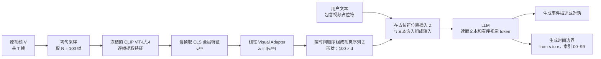

## 相关工作与架构整理

### 一句话总结

VTimeLLM 通过“高密度均匀采样 100 帧 + 直接将帧特征送入 LLM + 边界感知三阶段训练”，让 Video LLM 学会输出事件对应的精确起止位置。

## 1. 相关工作

### 1.1 现有 Video LLM 的不足

已有 Video LLM 能够进行整体视频描述或问答，但通常只能给出较粗粒度的内容总结，难以回答：

- 某个事件具体从什么时候开始？
- 到什么时候结束？
- 视频中多个事件各自对应哪个时间区间？

作者将这个能力称为：**细粒度视频时刻理解**（fine-grained video moment understanding），重点是理解事件内容，并找准事件边界。

### 1.2 现有两阶段训练流程的问题

常见 Video LLM 训练流程为：

```text
第一阶段：视觉 - 语言特征对齐
第二阶段：指令微调
```

作者认为，这种流程对“精确时间边界”学习不足，主要有两点原因：

1. 大规模视频文本数据往往只有粗略描述，且文本噪声较多；
2. 许多视频只描述单个事件，无法充分训练模型理解“一个视频中多个事件的边界”。

因此，VTimeLLM 在常见两阶段流程中加入了一个新的中间阶段：**边界感知阶段**（Boundary Perception）。

```text
特征对齐
  -> 边界感知
  -> 指令微调
```

### 1.3 两类细粒度时间理解任务

| 任务 | 输入 | 输出 | 核心要求 |
| --- | --- | --- | --- |
| 时间视频定位（Temporal Video Grounding） | 文字查询 + 视频 | 对应事件的起止时间 | 根据一句话找到事件在哪里发生 |
| 密集视频描述（Dense Video Captioning） | 视频 | 多个事件及各自时间区间、描述 | 找全视频中的多个事件，并分别说明其时间和内容 |

时间视频定位的传统方法又可分为：

- **候选提议式（proposal-based）**：先生成多个候选时间片段，再挑选与查询最匹配的片段；
- **直接预测式（proposal-free）**：不生成候选片段，直接预测事件开始和结束边界。

密集视频描述则同时要求“定位”和“描述”。早期方法常先定位、再描述；近期方法倾向于联合生成时间边界和文字描述。

## 2. VTimeLLM 架构：视频如何进入 LLM

VTimeLLM 的整体架构可以概括为：


### 2.1 均匀采样：将整段视频离散为 100 个位置

对于任意长度的视频，作者始终从头到尾**均匀采样 100 帧**，并保证第一帧和最后一帧被采到。

这样做的意义是：模型不直接输出真实秒数，而是先在统一的 `00 - 99` 帧索引范围内学习事件位置。

例如：

```text
from 20 to 45
```

表示：事件从均匀采样序列中的第 20 个位置开始，到第 45 个位置结束。

这个索引可以再映射回原视频的实际时间。

### 2.2 Visual Encoder：逐帧提取视觉特征

作者使用冻结的 **CLIP ViT-L/14** 作为视觉编码器。

每一帧经过 ViT 后会得到：

- 一个 `CLS token`：可看作该帧的全局语义摘要；
- 多个 patch token：表示图像不同局部区域的特征。

VTimeLLM 最终只取每帧的 **CLS 全局特征** 作为该帧表示。

### 2.3 Visual Adapter：把视觉特征翻译为 LLM 能理解的形式

CLIP 的特征空间与 LLM 的词向量空间不同，因此需要一个桥梁。

VTimeLLM 使用一个简单的**线性层**作为 Visual Adapter：

```text
每帧 CLS 特征
  -> 线性映射
  -> 与 LLM 隐藏维度一致的视觉 token
```

100 帧最终得到 100 个视觉 token。它们与用户问题的文本 token 一起输入 LLM。

### 2.4 时间关系由谁建模？

这是 VTimeLLM 与 TimeChat 很不同的一点。

VTimeLLM 的视觉侧没有使用专门的视频时序模块，例如 Video Q-Former 或时间感知帧编码器。作者的思路是：

- 帧本身已经按时间顺序排列；
- 视觉 token 也按该顺序输入 LLM；
- 因此由 LLM 从顺序 token 中学习帧之间的时间关系。

换句话说：

```text
TimeChat：
在视觉编码阶段显式加入时间信息，并通过滑动 Video Q-Former 建模时序。

VTimeLLM：
视觉侧只做逐帧编码和线性映射，
主要依赖连续输入的 token 顺序，以及后续的边界感知训练来学习时间边界。
```

### 2.5 输出格式：用文本生成时间边界

VTimeLLM 把时间定位转化为语言生成任务，采用：

```text
from s to e
```

其中：

- `s`：事件开始帧的索引；
- `e`：事件结束帧的索引；
- 范围为 `00 - 99`。

例如：

```text
from 20 to 45: the person closes the laptop.
```

这使同一个 LLM 既能生成事件描述，也能生成对应时间边界。

## 3. 架构部分最应记住的内容

| 问题 | VTimeLLM 的回答 |
| --- | --- |
| 如何让 LLM 看视频？ | 均匀采样 100 帧，逐帧编码为视觉 token。 |
| 如何让视觉 token 进入 LLM？ | 使用线性 Visual Adapter 映射到 LLM 的嵌入空间。 |
| 如何表示事件时间？ | 将视频统一离散为 `00 - 99` 的帧索引，生成 `from s to e`。 |
| 如何建模帧间时序？ | 不额外设置视觉时序模块，主要依赖顺序视觉 token 与 LLM。 |
| 真正的关键创新在哪里？ | 边界感知三阶段训练，而不是复杂的视觉架构。 |

## 4. 对动作序列检测项目的启发

VTimeLLM 的可借鉴之处是：把动作定位改写为统一的语言生成格式。

```text
from 20 to 45: 动作 A
from 46 to 68: 动作 B
from 69 to 85: 动作 C
```

这天然对应“动作序列检测”的输出需求：**动作类别 + 起止位置 + 动作顺序**。

但要注意一个局限：100 帧均匀采样使时间表示较粗。若原视频很长，两个相邻动作可能都落在同一个采样间隔内，边界就难以精确区分。这正是后续需要关注“采样密度、时间表示方式和边界精度”的原因。
